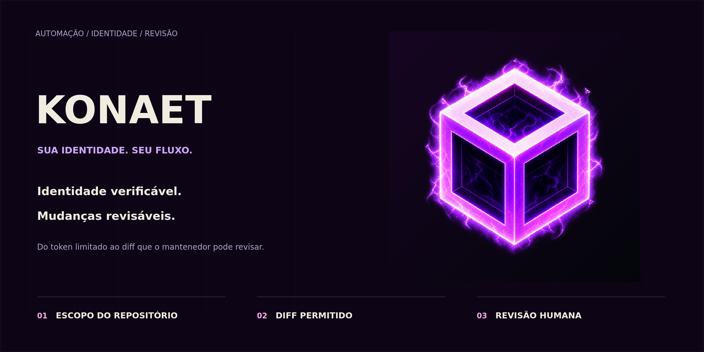
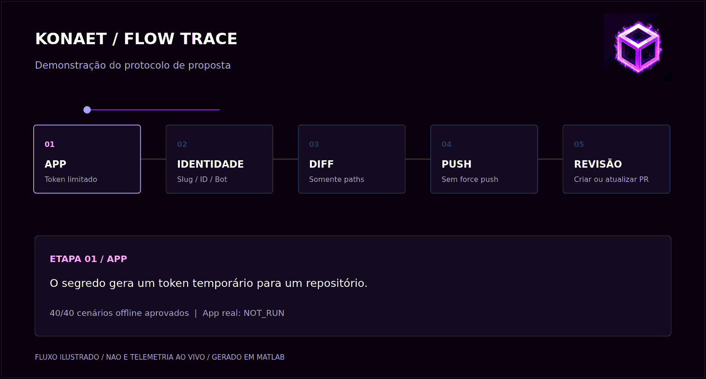
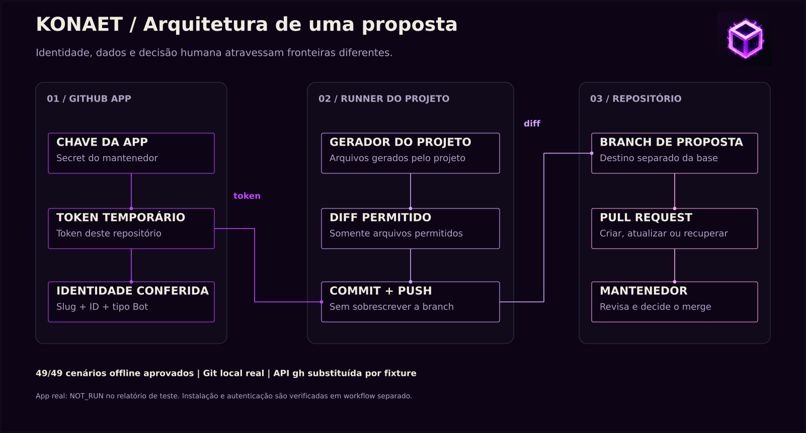

# Konaet Bot

**Da App ao diff. Do diff à revisão.**

Verified GitHub App identity and reviewable updates, with explicit repository scope.

[](https://github.com/7dsolv/konaet-bot/actions/workflows/verificar.yml)
[](LICENSE)

Uma Action para autenticar sua GitHub App e um módulo para transformar arquivos gerados pelo projeto em propostas revisáveis. A Konaet confere a identidade do bot, restringe o diff aos caminhos permitidos e entrega uma pull request ao mantenedor.



O GIF ilustra o protocolo. Os números exibidos vêm dos testes offline com **Git real em repositórios locais** e respostas de API controladas. A autenticação de uma App instalada é uma verificação separada. [Relatório reproduzível](docs/VALIDATION.md).

## O que o pacote faz

| Etapa | Comportamento |
| --- | --- |
| **Identidade** | Confere slug, ID, login e tipo `Bot` retornados pela API. |
| **Escopo** | Gera token temporário limitado ao repositório atual, revogado pela dependência oficial ao fim do job. |
| **Diff** | Aceita arquivos e diretórios literais em `paths`; recusa alterações inesperadas, inclusive as já staged. |
| **Git** | Preserva a branch base e usa push normal. Uma branch remota divergente interrompe a atualização. |
| **Proposta** | Cria ou atualiza a PR da branch; recupera falha depois do push sem criar outro commit. |
| **Decisão** | O mantenedor revisa e decide o merge. |



## Começar com sua App

1. Use o [cadastro oficial pré-preenchido](https://github.com/settings/apps/new?name=Konaet&description=Automacao%20Konaet%20com%20identidade%20propria%2C%20commits%20e%20propostas%20para%20revisao%20humana.&url=https%3A%2F%2Fgithub.com%2F7dsolv%2Fkonaet-bot&public=true&webhook_active=false&contents=write&pull_requests=write). Escolha um nome disponível para sua App.
2. Instale-a nos repositórios desejados com **Contents** e **Pull requests: Read and write**.
3. Em Actions, crie a variável `KONAET_APP_CLIENT_ID` e o segredo `KONAET_APP_PRIVATE_KEY`.
4. Em `expected-slug`, informe o slug da sua App. O padrão `konaet` exige a App oficial com esse slug.

A configuração está em [`github-app.json`](github-app.json). Pelo MATLAB, `abrir_cadastro_konaet` abre o mesmo formulário. A chave da App oficial permanece com seu mantenedor; outros usuários usam suas próprias credenciais.

```yaml
name: Propor resultados
on: [workflow_dispatch]
permissions:
  contents: read

jobs:
  propor:
    runs-on: ubuntu-latest
    steps:
      - uses: 7dsolv/konaet-bot@v1.1.0
        id: konaet
        with:
          client-id: ${{ vars.KONAET_APP_CLIENT_ID }}
          private-key: ${{ secrets.KONAET_APP_PRIVATE_KEY }}
          expected-slug: konaet # substitua pelo slug da sua App

      - uses: actions/checkout@v7
        with:
          token: ${{ steps.konaet.outputs.token }}
          fetch-depth: 0

      - name: Gerar arquivo demonstrativo
        run: |
          mkdir -p relatorios
          date -u '+Execucao em %Y-%m-%dT%H:%M:%SZ' > relatorios/estado.txt

      - uses: 7dsolv/konaet-bot/propose@v1.1.0
        with:
          token: ${{ steps.konaet.outputs.token }}
          bot-login: ${{ steps.konaet.outputs.bot-login }}
          bot-id: ${{ steps.konaet.outputs.bot-id }}
          paths: relatorios/estado.txt
          branch: konaet/resultado-${{ github.run_id }}
          base: ${{ github.event.repository.default_branch }}
          title: 'Konaet: revisar resultado gerado'
          body: O mantenedor pode conferir o diff antes do merge.
```

Para reutilizar uma branch entre execuções, faça checkout dela antes de gerar os arquivos. O [workflow manual do pacote](.github/workflows/propor.yml) já faz essa preparação. O [contrato de uso](docs/CONTRACT.md) detalha entradas, saídas, recuperação e conflitos.

## Testar e reproduzir a apresentação

No MATLAB em Linux, com Bash e Git:

```matlab
addpath('tests', 'visuals')
r = run_konaet_tests(pwd, fullfile(pwd, 'artifacts'));
render_konaet_assets(fullfile(pwd, 'artifacts', 'showcase'), r);
```

O CI executa esses comandos, actionlint e ShellCheck, verifica o contrato JSON e guarda o relatório e os visuais nos artifacts. Os desenhos são originais, gerados por [`visuals/render_konaet_assets.m`](visuals/render_konaet_assets.m): capa, ícone da App, diagrama SVG e GIF de 48 quadros. [Manifesto dos visuais](assets/showcase-manifest.json).

## Estado de publicação

O pacote é público e reutilizável sob licença MIT. A publicação da **Action** no Marketplace exige o contrato de desenvolvedor e a seleção de categoria na tela de release do GitHub. [Preparação da listagem](docs/MARKETPLACE.md).

A App oficial **Konaet** e a identidade `konaet[bot]` dependem de registro, instalação e validação real. O workflow **Verificar identidade real da App** faz essa validação depois da configuração. Os testes offline não a declaram executada.

O pacote automatiza identidade e propostas. Modelos científicos e pesquisa neural continuam nos projetos [RealidadeQuantica](https://github.com/7dsolv/RealidadeQuantica) e [Konaet-IA](https://github.com/7dsolv/Konaet-IA). Contribuições antigas de `github-actions[bot]` permanecem no histórico dos respectivos projetos.

Fontes do pacote em MATLAB e configurações YAML/JSON, sem fontes HTML, JavaScript ou Python. As Actions oficiais são dependências de infraestrutura. [Licença](LICENSE) · [Segurança](SECURITY.md) · [Mudanças](CHANGELOG.md).
